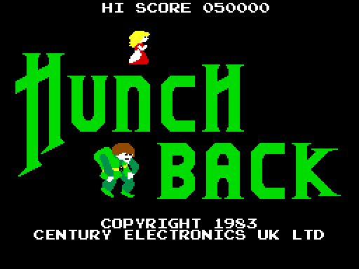
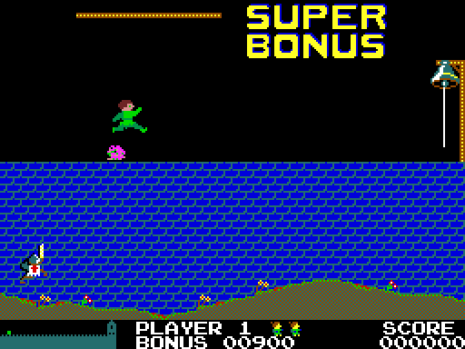
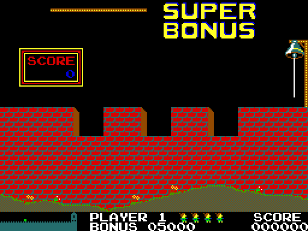
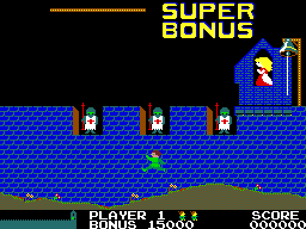

# Hunchback for the SAM Coupé

A version of Century Electronics' 1983 arcade game **Hunchback** for the SAM Coupé, written in
Z80 assembly for screen mode 4 (256×192, 16 colours). The layout, speeds, scoring and sounds
were measured from the arcade ROMs, so it plays the way the arcade does.

 

## Playing it

Boot `Hunchback.mgt` in SimCoupé or on a real SAM (insert the disk and
press F9). After the Lightning Studios intro, the loading screen stays up while the game loads
and the game starts by itself. Press any key on the title screen for the menu:
**1** insert coin, **2** start, **3** redefine keys.

| Action | Keys |
|---|---|
| Left | O, cursor left, 6 (joystick) |
| Right | P, cursor right, 7 (joystick) |
| Jump | SPACE, cursor up, 0 or 9 (joystick) |

Run along the castle wall and ring the bell at the far end before the climbing knight reaches
the top. Jump the fireballs, arrows, gaps and pikemen, swing across the fire pits on the
ropes, and rescue Esmeralda from her tower on screen 15.

## What's in it

- **All 15 arcade screens** in arcade order, then the belfry bonus screen, then round again
  faster.
- **Arcade timing and scoring**, measured from the ROMs: walking and jump speeds, missile
  timings, the knight's climb, the bell bonus, and five bells in a row for the super bonus.
  Losing a life empties the bell rope, as in the arcade.
- **Wall colours from Century's original board.** The castle starts blue, turns red at
  screen 5, then purple, olive and grey-green as you go on.
- **Arcade sound.** The effects and tunes were taken from the arcade's sound CPU frame by
  frame and replayed on the SAM's SAA1099.
- **Attract mode** with the title, a demo game, the league table and the instructions, plus
  coins and credits, redefinable keys, name entry for the top five, and a bonus man at 10,000.
- **Smooth display:** double-buffered at 25 frames a second, with flips timed to the frame
  interrupt so there's no tearing.

 

The full description of the game, its screens and the arcade measurements is in
[docs/manual.md](docs/manual.md).

## Building from source

```
python3 build.py path/to/HunchbackFN.mgt  [Hunchback.mgt]
```

You need Python 3 and numpy. The build reads the graphics from the original artwork disk,
`HunchbackFN.mgt` (the loading screen, title, mock-ups and the `HB SP` sprite page), which isn't
included here. It cuts the sprites straight out of those screens, assembles the game with
the bundled Z80 assembler, and writes a bootable MasterDOS disk.

| Path | What it is |
|---|---|
| `src/hunchback.asm` | The game |
| `src/attract.asm` | Title, attract mode, name entry and the new-game intro |
| `src/stub.asm` | The 72-byte loader that relocates the game into a free page pair |
| `src/intro/` | The Lightning Studios intro and its BASIC loader |
| `src/snd_data.bin` | The arcade sound data (made by `tools/arcade_sound/mksnd.py`) |
| `tools/mkgfx.py` | Cuts the graphics out of the original screens |
| `tools/z80asm.py` | Two-pass Z80 assembler |
| `tools/mkdisk.py` | Writes the disk and its BASIC loader |
| `tools/samemu.c` | A small headless SAM emulator core, used for testing |
| `tools/rom_check/` | The 2650 disassembler and checking scripts used against the arcade ROMs |

## Credits

- **Hunchback** © 1983 Century Electronics.
- Graphics from the `HunchbackFN.mgt` artwork disk; intro from Lightning Studios.
- Arcade behaviour checked against the MAME ROM sets `hunchbkd` (Donkey Kong conversion) and
  `hunchbak` (Century's original board). No ROMs are included in this repository.
